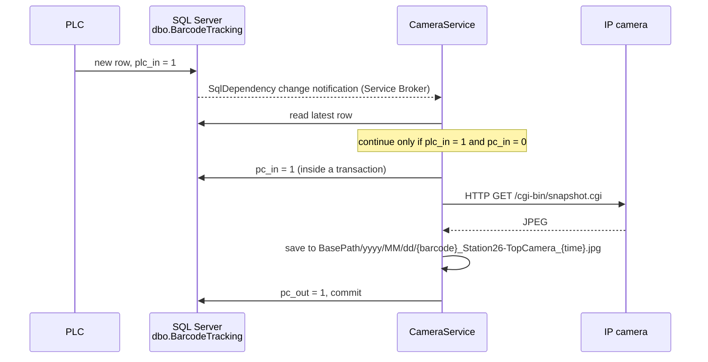

# CameraService

A .NET 8 **Windows Service** that takes an IP-camera snapshot of every product
passing a production-line station — triggered in real time by the line's PLC
through SQL Server, without polling.

Built during my software engineering internship at **Ferre (Femaş Metal A.Ş.)**
in February 2026 for station 26 of the built-in oven production line, and
handed over to the company's IT team.

## How it works



- **Event-driven, not polling** — `SqlDependency` subscribes to the tracking
  table, so the service reacts as soon as the PLC writes a row and puts no
  constant load on the database.
- **PLC ↔ PC handshake** — `plc_in` / `pc_in` / `pc_out` flags show which side
  has taken over each record. Only rows with `plc_in = 1` and `pc_in = 0` are
  processed, which stops the service's own updates from re-triggering it.
- **All or nothing** — the flag updates and the snapshot run in one database
  transaction; if the camera or disk fails, the transaction is rolled back and
  the record is retried after one second.
- **Operable** — runs 24/7 as a Windows Service, writes daily rolling Serilog
  log files (last 7 kept), and archives images in date-based folders.

## Tech stack

.NET 8 Worker Service · Windows Service hosting · Entity Framework Core (SQL Server) ·
Microsoft.Data.SqlClient `SqlDependency` · `HttpClientFactory` · Serilog

## Project structure

```
CameraService/
├── Program.cs                          Host, DI, Serilog, Windows Service setup
├── appsettings.json                    Connection string, camera and storage settings
└── Features/SnapshotCapture/           Vertical slice for the whole feature
    ├── DatabaseTriggerWorker.cs        BackgroundService listening to SQL Server
    ├── SnapshotCaptureHandler.cs       Transactional flag update + capture + save
    ├── CameraClient.cs / ICameraClient.cs         HTTP snapshot client
    ├── LocalImageStorage.cs / IImageStorage.cs    Date-based image archive
    ├── AppDbContext.cs                 EF Core context
    └── BarcodeRecord.cs                dbo.BarcodeTracking entity
```

## Configuration

`CameraService/appsettings.json` (the values in this repository are placeholders):

```json
{
  "ConnectionStrings": {
    "DefaultConnection": "Server=...;Database=...;Integrated Security=true;TrustServerCertificate=True;"
  },
  "CameraSettings": {
    "SnapshotUrl": "http://YOUR_CAMERA_IP/cgi-bin/snapshot.cgi",
    "Username": "YOUR_CAMERA_USERNAME",
    "Password": "YOUR_CAMERA_PASSWORD"
  },
  "StorageSettings": {
    "BasePath": "C:\\Snapshots",
    "LogPath": "C:\\CameraService\\logs.txt"
  }
}
```

## Running

`SqlDependency` needs Service Broker enabled on the database:

```sql
ALTER DATABASE [YourDatabase] SET ENABLE_BROKER;
```

Run locally:

```bash
dotnet run --project CameraService
```

Install as a Windows Service (from an elevated prompt):

```bash
dotnet publish CameraService -c Release -o C:\Services\CameraService
sc.exe create CameraService binPath= "C:\Services\CameraService\CameraService.exe" start= auto
sc.exe start CameraService
```
